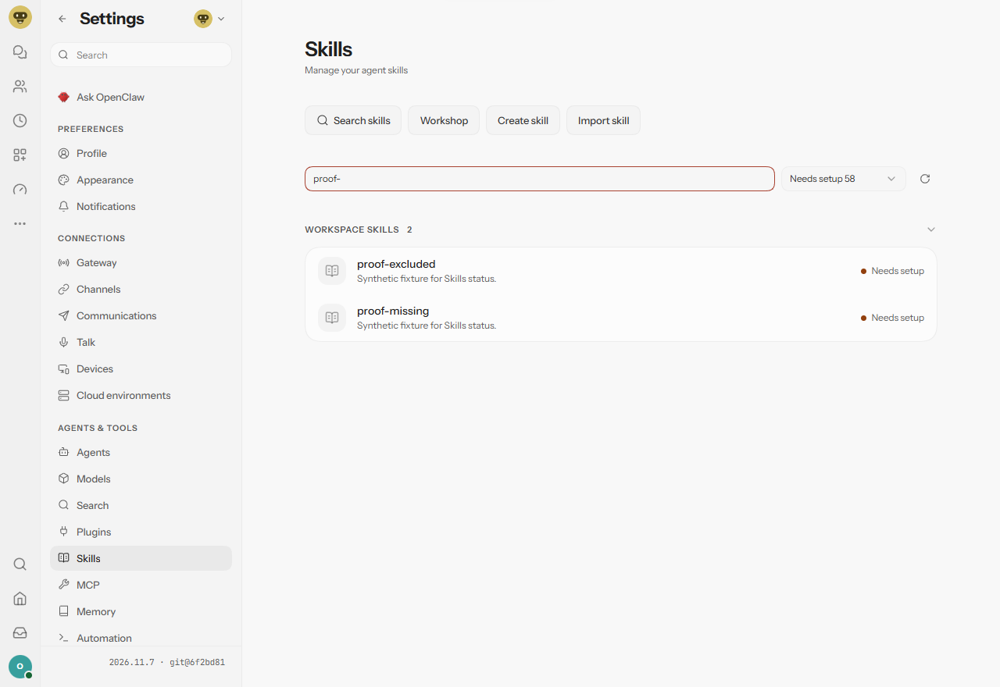
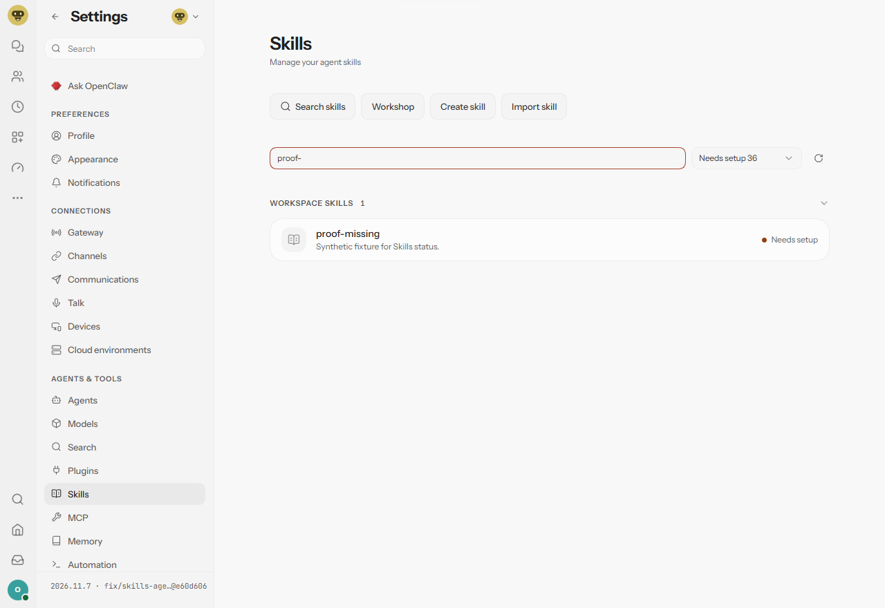
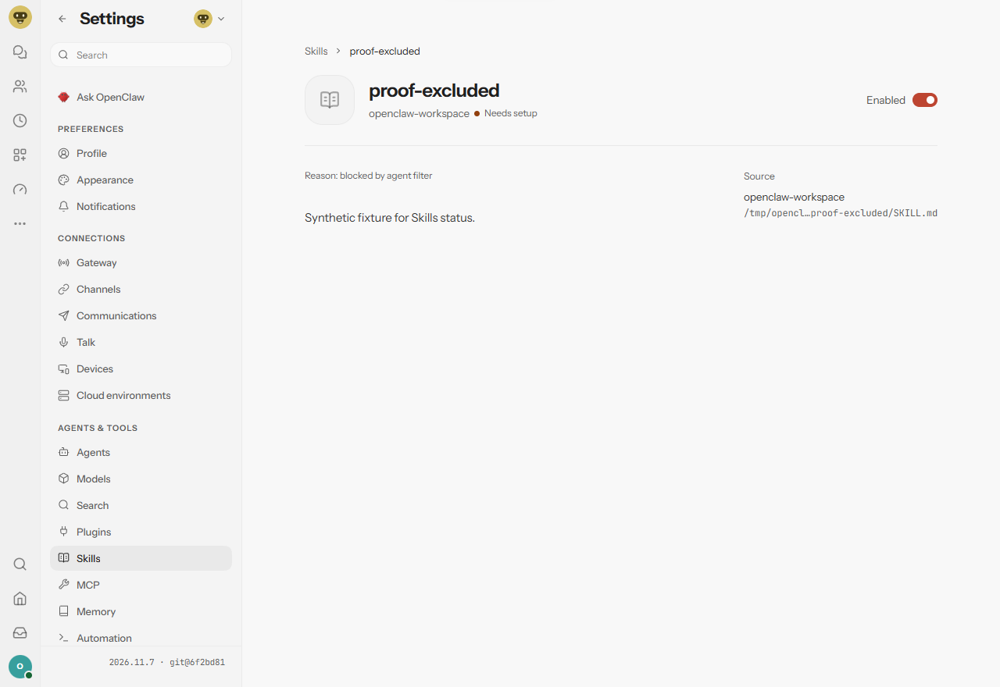
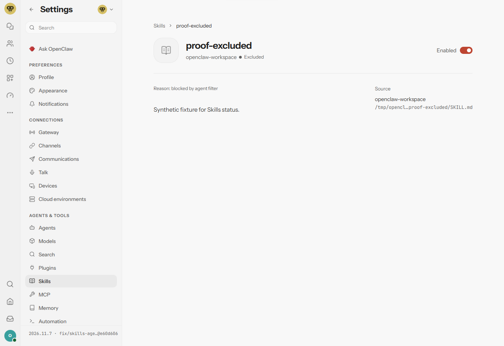

# PR #198090: current Skills UI proof

Screenshots for https://github.com/openclaw/openclaw/pull/198090, captured on 2026-11-23 from a real production Gateway and Chromium using disposable synthetic skills and agent configurations. No RPC stubs were used.

- Before UI: upstream `6f2bd815fecb4427081663be328946ba184e6514`, built with `pnpm ui:build`.
- After UI: candidate `e60d606f99b1501c079dcfb7ef456d060bf75565`, from a clean complete `pnpm build` (exit 0, 492.870 seconds).
- Both runs use the production Gateway from `e60d606f99b1501c079dcfb7ef456d060bf75565`. All non-UI sources are identical to the pinned upstream commit. The before run serves independently built upstream UI assets through `gateway.controlUi.root`; it is not a full upstream Gateway build.
- Build toolchain: Linux, Node 26.12.1, pnpm 12.15.0. The 96 focused tests and UI type checks used Node 24.22.1. Existing UI size-budget warnings remain on both builds.
- Served HTML and assets were checked against their source build. Before index SHA-256: `c7b0bd3950e9f62565857ff1d440a0f9700da5e51cd9c113af4aa9059b07d698`; after index: `9330022e299e6b386a833979b6e50f5dc7ffbeee9a531f801f193570a3177ba4`.

| Agent | Before Needs setup | After Needs setup | After Excluded | CLI missing prerequisites |
| --- | ---: | ---: | ---: | ---: |
| main allowlist | 58 | 36 | 22 | 36 |
| empty allowlist | 55 | 36 | 19 | 36 |

The inventory screenshots filter names by `proof-`. This only narrows visible rows; the status selector shows the whole agent inventory count. `proof-excluded` has no missing prerequisite but is excluded by the agent. `proof-missing` has a deliberately absent binary. The detail screenshots show the exclusion reason and the unchanged globally enabled toggle.

Real agent switching, status filters, the independent detail page and breadcrumb return passed. The candidate was checked at 400, 820 and 1280 px without horizontal overflow. Gateway processes, loopback ports and temporary runtime state were cleaned up.

| File | SHA-256 |
| --- | --- |
| before-inventory.png | 8b342ff0bcda6c53ad9dd72d32864ecef902c29d4c433127a5da0ff815411f51 |
| before-detail.png | 62cedab9727f1674a51fd802b588350d5df1390bb3e8cb2e80fb868b7d0f1747 |
| after-inventory.png | 7d56ecf017fb0f04f409f326a64e993bfc01a47a519a508ab196e2dfb0b5a910 |
| after-detail.png | fe03749bbb8c4d4231dba9faa2e16636740ac9ff75c179ecfa77e16c082bc2e3 |

This branch contains review evidence only; these images are not part of the product PR diff.
